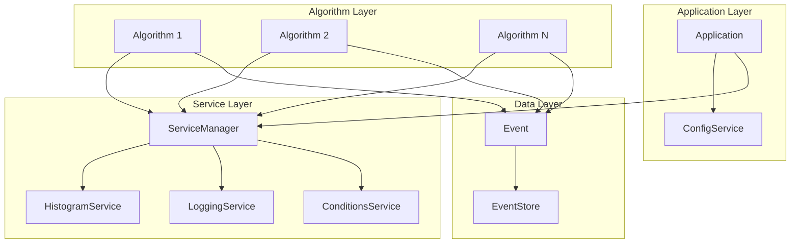

# Design Document: Code Quality Improvements

## Overview

This design document describes improvements to the CLAS12 Analysis Framework to enhance code quality, modularity, and testability. The improvements focus on six key areas:

1. **Configuration Management** - External TOML-based configuration system
2. **Enhanced Error Handling** - Result types with error context
3. **Improved Service Architecture** - Typed service handles with dependency management
4. **Algorithm Communication** - Type-safe event store for inter-algorithm data sharing
5. **Logging Infrastructure** - Structured logging with configurable levels
6. **Unit Testing** - Comprehensive test coverage for framework components

The design follows modern C++20 patterns and draws inspiration from established HEP frameworks (Gaudi, Athena, CMSSW).

## Architecture



## Components and Interfaces

### 1. Configuration Service

A new `ConfigService` provides centralized configuration management using TOML files.

```cpp
namespace Framework {

class ConfigService : public Service {
public:
    explicit ConfigService(std::string config_path);
    
    // Type-safe configuration access
    template<typename T>
    auto get(const std::string& key) const -> Result<T>;
    
    template<typename T>
    auto get(const std::string& key, T default_value) const -> T;
    
    // Check if key exists
    auto has(const std::string& key) const -> bool;
    
    // Validate required fields
    auto validate(const std::vector<std::string>& required_keys) const -> Result<void>;
    
private:
    toml::table m_config;
    std::string m_config_path;
};

} // namespace Framework
```

### 2. Enhanced StatusCode with Error Context

The `StatusCode` class is extended to carry error messages.

```cpp
namespace Framework {

class StatusCode {
public:
    enum class Code { SUCCESS = 0, FAILURE = 1 };
    
    // Constructors
    static auto success() -> StatusCode;
    static auto failure(std::string message) -> StatusCode;
    
    // Accessors
    auto is_success() const -> bool;
    auto is_failure() const -> bool;
    auto message() const -> const std::string&;
    
    operator bool() const;
    
private:
    Code m_code;
    std::string m_message;
};

} // namespace Framework
```

### 3. Result Type for Error Handling

A generic `Result<T>` type for operations that can fail.

```cpp
namespace Framework {

template<typename T>
class Result {
public:
    // Factory methods
    static auto ok(T value) -> Result<T>;
    static auto error(std::string message) -> Result<T>;
    
    // Accessors
    auto is_ok() const -> bool;
    auto is_error() const -> bool;
    auto value() const -> const T&;
    auto value_or(T default_val) const -> T;
    auto error_message() const -> const std::string&;
    
    // Monadic operations
    template<typename F>
    auto map(F&& func) const -> Result<std::invoke_result_t<F, T>>;
    
    template<typename F>
    auto and_then(F&& func) const -> std::invoke_result_t<F, T>;
    
private:
    std::variant<T, std::string> m_data;
};

// Specialization for void
template<>
class Result<void>;

} // namespace Framework
```

### 4. Typed Service Handles

Service handles that validate availability at initialization time.

```cpp
namespace Framework {

template<typename T>
class ServiceHandle {
public:
    explicit ServiceHandle(const std::string& name);
    
    // Initialize - must be called during algorithm init
    auto initialize(ServiceManager& svc_mgr) -> StatusCode;
    
    // Access operators
    auto operator->() const -> T*;
    auto operator*() const -> T&;
    auto get() const -> T*;
    
    // Check validity
    auto is_valid() const -> bool;
    explicit operator bool() const;
    
private:
    std::string m_name;
    T* m_service = nullptr;
};

} // namespace Framework
```

### 5. Service Dependency Management

The `ServiceManager` is enhanced to handle service dependencies.

```cpp
namespace Framework {

class ServiceManager {
public:
    // Add service with optional dependencies
    auto add_service(std::unique_ptr<IService> service,
                     std::vector<std::string> dependencies = {}) -> StatusCode;
    
    // Initialize all services in dependency order
    auto initialize_all() -> StatusCode;
    
    // Type-safe service retrieval
    template<typename T>
    auto get_service(const std::string& name) -> T*;
    
private:
    std::map<std::string, std::unique_ptr<IService>> m_services;
    std::map<std::string, std::vector<std::string>> m_dependencies;
    
    auto topological_sort() const -> Result<std::vector<std::string>>;
};

} // namespace Framework
```

### 6. Enhanced Event Store

The `Event` class event store is improved for type safety.

```cpp
namespace Framework {

class Event {
public:
    // Type-safe store with move semantics
    template<typename T>
    auto store(const std::string& key, T value) -> void;
    
    // Type-safe retrieval returning optional
    template<typename T>
    auto retrieve(const std::string& key) const -> std::optional<T>;
    
    // Check if key exists
    auto contains(const std::string& key) const -> bool;
    
    // Store particle collections
    template<typename ParticleType>
    auto store_particles(const std::string& key, 
                         std::vector<ParticleType> particles) -> void;
    
    template<typename ParticleType>
    auto get_particles(const std::string& key) const 
        -> const std::vector<ParticleType>&;
    
private:
    std::map<std::string, std::any> m_store;
};

} // namespace Framework
```

## Data Models

### Configuration File Format (TOML)

```toml
[application]
name = "CLAS12 Analysis"
max_events = 100000
num_threads = 4

[input]
files = ["data/run_5032.hipo", "data/run_5033.hipo"]

[output]
histogram_file = "histograms.root"
ntuple_file = "ntuples.root"
log_file = "analysis.log"

[logging]
level = "INFO"  # DEBUG, INFO, WARNING, ERROR, CRITICAL
colored = true
console = true

[electron_selection]
momentum_cut = 0.8
chi2pid_cut = 3.0
target = "LD2"
polarity = "Outbending"
```

### Error Context Structure

```cpp
struct ErrorContext {
    std::string message;
    std::string source;      // Component that generated error
    std::string file;        // Source file (optional)
    int line;                // Line number (optional)
};
```

## Correctness Properties

*A property is a characteristic or behavior that should hold true across all valid executions of a system-essentially, a formal statement about what the system should do. Properties serve as the bridge between human-readable specifications and machine-verifiable correctness guarantees.*

Based on the acceptance criteria analysis, the following correctness properties must be verified through property-based testing:

### Property 1: Configuration Round-Trip Consistency

*For any* valid TOML configuration containing typed values (integers, doubles, strings, booleans), storing the configuration and retrieving values by key SHALL return the original values with correct types.

**Validates: Requirements 1.1, 1.3, 1.4**

### Property 2: StatusCode Error Message Preservation

*For any* StatusCode created with a failure status and error message, the StatusCode SHALL preserve and return the exact error message when queried.

**Validates: Requirements 2.1, 2.2**

### Property 3: Service Dependency Ordering

*For any* set of services with declared dependencies forming a valid DAG (no cycles), the ServiceManager SHALL initialize services such that each service is initialized only after all its dependencies have been initialized.

**Validates: Requirements 3.1, 3.3**

### Property 4: Event Store Round-Trip

*For any* data object stored in the Event store with a unique key, retrieving the data by the same key SHALL return an equivalent object, and retrieving with a non-existent key SHALL return an empty optional.

**Validates: Requirements 4.1, 4.2, 4.3, 4.4**

### Property 5: Log Level Filtering

*For any* log message emitted at a given level, when the LoggingService minimum level is set higher than the message level, the message SHALL be suppressed (not output).

**Validates: Requirements 5.2**

### Property 6: Log Message Format Completeness

*For any* log message emitted through the LoggingService, the formatted output SHALL contain the timestamp, log level string, and source component name.

**Validates: Requirements 5.1, 5.3**

## Error Handling

### Error Propagation Strategy

1. **Result Type**: Operations that can fail return `Result<T>` instead of throwing exceptions
2. **StatusCode**: Lifecycle methods (initialize, execute, finalize) return `StatusCode` with error context
3. **Exception Boundary**: The Application event loop catches exceptions from algorithms and logs them

### Error Categories

| Category | Handling | Example |
|----------|----------|---------|
| Configuration Error | Return failure StatusCode at init | Missing config file |
| Service Error | Return failure StatusCode, stop init | Service dependency cycle |
| Algorithm Error | Log and continue to next event | Exception in execute() |
| I/O Error | Return Result with error context | File not found |

### Exception Safety

- All framework components provide basic exception safety (no resource leaks)
- Event processing continues after algorithm exceptions
- Services are finalized even if some algorithms fail

## Testing Strategy

### Dual Testing Approach

The framework uses both unit tests and property-based tests:

- **Unit tests**: Verify specific examples, edge cases, and integration points
- **Property-based tests**: Verify universal properties across all valid inputs

### Property-Based Testing Framework

The project will use **RapidCheck** for C++ property-based testing. Each property test will run a minimum of 100 iterations.

### Test Organization

```
test/
├── unit/
│   ├── test_config_service.cpp
│   ├── test_status_code.cpp
│   ├── test_result.cpp
│   ├── test_service_manager.cpp
│   ├── test_event_store.cpp
│   ├── test_logging_service.cpp
│   └── test_cutflow.cpp
└── property/
    ├── test_config_roundtrip.cpp
    ├── test_statuscode_properties.cpp
    ├── test_service_ordering.cpp
    ├── test_event_store_properties.cpp
    └── test_logging_properties.cpp
```

### Test Annotations

Each property-based test MUST be annotated with a comment referencing the correctness property:

```cpp
// **Feature: code-quality-improvements, Property 1: Configuration Round-Trip Consistency**
RC_GTEST_PROP(ConfigService, RoundTrip, (std::string key, int value)) {
    // Test implementation
}
```

### Unit Test Coverage

Unit tests will cover:
- Service lifecycle (initialize → use → finalize)
- Event particle access and store operations
- Cutflow cut registration, passing, and statistics
- Error conditions and edge cases
