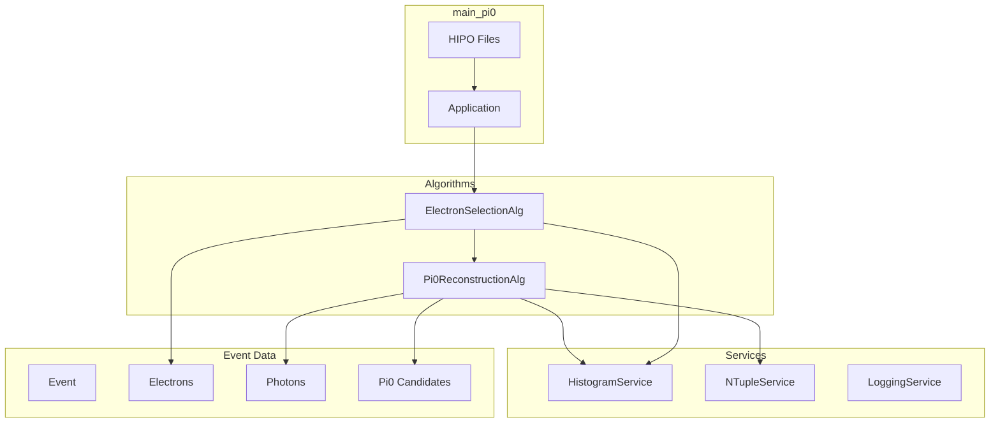

# Design Document: Pi0 Reconstruction

## Overview

This design document describes the implementation of a π⁰ (neutral pion) reconstruction algorithm for the CLAS12 Analysis Framework. The π⁰ meson decays to two photons with ~99% branching ratio, making photon pair reconstruction the primary method for identifying π⁰ candidates.

The implementation consists of:
1. **Pi0ReconstructionAlg** - An algorithm that reconstructs π⁰ candidates from photon pairs
2. **main_pi0.cpp** - An executable that chains electron selection with π⁰ reconstruction and writes results to an NTuple

## Architecture



## Components and Interfaces

### 1. Pi0ReconstructionAlg

The main algorithm for π⁰ reconstruction from photon pairs.

```cpp
namespace Algorithms {

class Pi0ReconstructionAlg : public Framework::Algorithm {
public:
    explicit Pi0ReconstructionAlg(
        std::string name = "Pi0ReconstructionAlg",
        double min_photon_energy = 0.1,      // GeV
        double pi0_mass_window = 0.03        // GeV (±30 MeV around 135 MeV)
    );
    
    auto initialize() -> Framework::StatusCode override;
    auto execute(Framework::Event& event) -> Framework::StatusCode override;
    auto finalize() -> Framework::StatusCode override;
    
private:
    // Configuration
    double m_min_photon_energy;
    double m_pi0_mass_window;
    static constexpr double PI0_MASS = 0.135;  // GeV/c²
    
    // Services
    Framework::ServiceHandle<Framework::HistogramService> m_hist_svc;
    Framework::ServiceHandle<Framework::NTupleService> m_ntuple_svc;
    Framework::ServiceHandle<Framework::LoggingService> m_log_svc;
    
    // Cutflow
    Framework::Cutflow m_cutflow;
    
    // Helper methods
    auto select_photons(const std::vector<Core::Particle>& photons) 
        -> std::vector<Core::Particle>;
    auto calculate_invariant_mass(const Core::Particle& g1, const Core::Particle& g2) 
        -> double;
    auto find_best_pi0(const std::vector<Core::Particle>& photons) 
        -> std::optional<std::tuple<Core::Particle, Core::Particle, double>>;
};

} // namespace Algorithms
```

### 2. Invariant Mass Calculation

The invariant mass of two photons is calculated using their four-momenta:

```cpp
auto calculate_invariant_mass(const Core::Particle& g1, const Core::Particle& g2) -> double {
    // Get four-vectors
    auto p1 = g1.PxPyPzEVector();
    auto p2 = g2.PxPyPzEVector();
    
    // Sum four-momenta
    auto p_total = p1 + p2;
    
    // Return invariant mass
    return p_total.M();
}
```

### 3. Photon Pair Combination

For n photons, generate all n*(n-1)/2 unique pairs:

```cpp
auto find_best_pi0(const std::vector<Core::Particle>& photons) 
    -> std::optional<std::tuple<Core::Particle, Core::Particle, double>> {
    
    if (photons.size() < 2) return std::nullopt;
    
    std::optional<std::tuple<Core::Particle, Core::Particle, double>> best;
    double best_mass_diff = std::numeric_limits<double>::max();
    
    for (size_t i = 0; i < photons.size(); ++i) {
        for (size_t j = i + 1; j < photons.size(); ++j) {
            double mass = calculate_invariant_mass(photons[i], photons[j]);
            double mass_diff = std::abs(mass - PI0_MASS);
            
            // Check mass window
            if (mass_diff < m_pi0_mass_window && mass_diff < best_mass_diff) {
                best_mass_diff = mass_diff;
                best = std::make_tuple(photons[i], photons[j], mass);
            }
        }
    }
    
    return best;
}
```

### 4. main_pi0.cpp Structure

```cpp
int main(int argc, char* argv[]) {
    // Parse arguments
    std::string data_dir = (argc > 1) ? argv[1] : "data/";
    long max_events = (argc > 2) ? std::stol(argv[2]) : -1;
    
    // Create application
    Framework::Application app("Pi0 Analysis");
    
    // Configure services
    auto hist_svc = std::make_unique<Framework::HistogramService>();
    hist_svc->set_output_file("pi0_analysis.root");
    
    auto ntuple_svc = std::make_unique<Framework::NTupleService>();
    ntuple_svc->set_output_file("pi0_analysis.root");
    
    app.service_manager().add_service(std::move(hist_svc));
    app.service_manager().add_service(std::move(ntuple_svc));
    
    // Add algorithms in sequence
    app.add_algorithm(std::make_unique<Algorithms::ElectronSelectionAlg>());
    app.add_algorithm(std::make_unique<Algorithms::Pi0ReconstructionAlg>());
    
    // Configure input and run
    app.set_input_files(Core::read_recursive_file_in_directory(data_dir));
    app.set_max_events(max_events);
    
    app.initialize();
    app.run();
    app.finalize();
    
    return 0;
}
```

## Data Models

### NTuple Branch Structure

The output NTuple "pi0_events" will contain:

| Branch | Type | Description |
|--------|------|-------------|
| e_p | double | Electron momentum (GeV/c) |
| e_theta | double | Electron polar angle (deg) |
| e_phi | double | Electron azimuthal angle (deg) |
| e_vz | double | Electron vertex z (cm) |
| g1_E | double | Photon 1 energy (GeV) |
| g1_theta | double | Photon 1 polar angle (deg) |
| g1_phi | double | Photon 1 azimuthal angle (deg) |
| g2_E | double | Photon 2 energy (GeV) |
| g2_theta | double | Photon 2 polar angle (deg) |
| g2_phi | double | Photon 2 azimuthal angle (deg) |
| pi0_mass | double | Reconstructed π⁰ mass (GeV/c²) |
| pi0_p | double | π⁰ momentum (GeV/c) |
| pi0_theta | double | π⁰ polar angle (deg) |
| pi0_phi | double | π⁰ azimuthal angle (deg) |

### Histogram Structure

```
/Pi0/
├── photon_energy        # All photon energies
├── photon_theta         # All photon polar angles
├── n_photons            # Number of photons per event
├── gg_mass_all          # All γγ invariant masses
├── gg_mass_selected     # Selected π⁰ candidate masses
├── pi0_momentum         # π⁰ momentum
├── pi0_theta            # π⁰ polar angle
└── opening_angle        # Opening angle between photons
```

## Correctness Properties

*A property is a characteristic or behavior that should hold true across all valid executions of a system-essentially, a formal statement about what the system should do. Properties serve as the bridge between human-readable specifications and machine-verifiable correctness guarantees.*

### Property 1: Photon Energy Filtering

*For any* photon with energy below the minimum threshold, the photon SHALL be excluded from the selected photon list.

**Validates: Requirements 1.2**

### Property 2: Photon Pair Combinatorics

*For any* set of n selected photons where n ≥ 2, the algorithm SHALL generate exactly n*(n-1)/2 unique photon pairs for invariant mass calculation.

**Validates: Requirements 2.1**

### Property 3: Invariant Mass Calculation Correctness

*For any* two photons with known four-momenta, the calculated invariant mass SHALL equal sqrt((E1+E2)² - (p1+p2)²) within floating-point precision.

**Validates: Requirements 2.2**

### Property 4: Mass Window Filtering

*For any* photon pair with invariant mass outside the window [PI0_MASS - window, PI0_MASS + window], the pair SHALL be excluded from π⁰ candidates.

**Validates: Requirements 2.3**

### Property 5: Best Candidate Selection

*For any* set of π⁰ candidates passing the mass window cut, the selected candidate SHALL have the smallest |mass - PI0_MASS| value among all candidates.

**Validates: Requirements 2.4**

## Error Handling

| Scenario | Handling |
|----------|----------|
| No photons in event | Return SUCCESS, increment "No Photons" cutflow counter |
| Only 1 photon | Return SUCCESS, increment "< 2 Photons" cutflow counter |
| No π⁰ candidate in mass window | Return SUCCESS, increment "No Pi0 Candidate" counter |
| NTupleService unavailable | Log warning, continue without NTuple output |
| HistogramService unavailable | Return FAILURE during initialize |

## Testing Strategy

### Property-Based Testing Framework

The project will use **RapidCheck** for C++ property-based testing. Each property test will run a minimum of 100 iterations.

### Test Annotations

Each property-based test MUST be annotated with a comment referencing the correctness property:

```cpp
// **Feature: pi0-reconstruction, Property 3: Invariant Mass Calculation Correctness**
RC_GTEST_PROP(Pi0Reconstruction, InvariantMassCorrectness, 
              (double E1, double px1, double py1, double pz1,
               double E2, double px2, double py2, double pz2)) {
    // Test implementation
}
```

### Unit Test Coverage

Unit tests will cover:
- Photon selection with various energy values
- Pair generation for different photon counts
- Invariant mass calculation with known values
- Mass window filtering edge cases
- Best candidate selection with multiple candidates
- NTuple branch registration and filling
