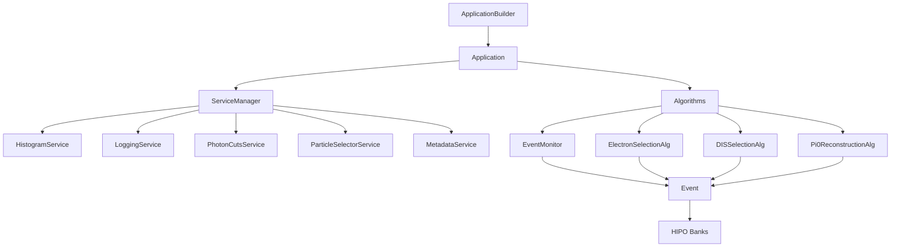

# CLAS12 Analysis Framework

**A modern particle physics analysis framework for CLAS12 data**

[]()
[]()
[]()
[]()

---

## Overview

The CLAS12 Analysis Framework is a modern C++20 framework designed to make particle physics analysis:

- **Cleaner** - Less boilerplate, more physics
- **Safer** - Type-safe interfaces, automated testing
- **Faster** - Built-in parallelization, optimized data structures
- **Maintainable** - Modular design, reusable components

## Key Features

!!! success "ApplicationBuilder Pattern"
    Fluent API for cleaner application setup with `with_standard_services()` and type-safe algorithm configuration.

!!! success "Service-Oriented Architecture"
    Modular, reusable services including HistogramService, PhotonCutsService (AI/ML-based), ParticleSelectorService, and more.

!!! success "Algorithm Framework"
    Clean separation with initialize/execute/finalize lifecycle following Gaudi/Athena patterns. Includes specialized types like `MonitoringAlgorithm` and `FilterAlgorithm`.

!!! success "Event Data Model"
    High-level interface abstracting HIPO banks with lazy loading for optimal performance.

!!! success "Cutflow System"
    Automatic efficiency tracking with formatted output tables.

!!! success "Built-in Algorithms"
    Ready-to-use algorithms: ElectronSelectionAlg, DISSelectionAlg, Pi0ReconstructionAlg, EventMonitor.

!!! success "Scaffolding System"
    Python script to generate complete analysis directories with algorithms, build files, and proper structure.

## Quick Start

```bash
# Clone the repository
git clone https://github.com/mathieuouillon/clas-framework clas12-framework
cd clas12-framework

# Configure and build
meson setup build
meson compile -C build

# Run example
./build/examples/example_simple_algorithm data/data.hipo
```

## Project Structure

The framework is organized into modular components:

```
clas-analysis-1/
├── framework/          # Core reusable framework library
│   └── include/clas12/framework/
│       ├── Core.hpp    # All-in-one convenience include
│       ├── core/       # Algorithm, Application, Event, etc.
│       └── services/   # HistogramService, NTupleService, etc.
├── clas12/             # CLAS12-specific components
│   └── include/clas12/
│       ├── CLAS12.hpp  # All-in-one convenience include
│       ├── Particle.hpp, PIDs.hpp, etc.
│       └── physics/    # Kinematics, DISAnalysis, etc.
├── algorithms/         # Standard physics algorithms
│   └── include/clas12/algorithms/
│       ├── selection/  # ElectronSelectionAlg, PionSelectionAlg
│       ├── reconstruction/  # Pi0ReconstructionAlg, LambdaReconstructionAlg
│       └── monitoring/ # EventMonitor
├── analyses/           # User analysis executables
├── examples/           # Learning examples with READMEs
├── templates/          # Scaffolding for new analyses
│   └── create_analysis.py
└── tools/              # Utility tools (batch submission)
```

## Namespaces

| Namespace | Description |
|-----------|-------------|
| `clas12::framework` | Core framework (Application, Algorithm, Services) |
| `clas12` | CLAS12-specific (Particle, PIDs, Target, etc.) |
| `clas12::algorithms` | Standard algorithms (ElectronSelectionAlg, etc.) |
| `clas12::physics` | Physics utilities (Kinematics, DISAnalysis, etc.) |

## Architecture



## Example Analysis

Using the new **ApplicationBuilder** pattern (recommended):

```cpp
#include <clas12/framework/core/ApplicationBuilder.hpp>
#include <clas12/algorithms/selection/ElectronSelectionAlg.hpp>
#include <clas12/algorithms/monitoring/EventMonitor.hpp>

int main() {
    auto app = clas12::framework::make_application("MyAnalysis")
        .with_input_files({"data/run_5032.hipo"})
        .with_output("output.root")
        .with_threads(4)
        .with_standard_services()
        .add_algorithm<clas12::algorithms::EventMonitor>("EventMonitor")
        .add_algorithm<clas12::algorithms::ElectronSelectionAlg>(
            "ElectronSelection", clas12::Target::LD2, clas12::Polarity::Outbending)
        .build();

    app.initialize();
    app.run();
    app.finalize();

    return 0;
}
```

Or using the traditional approach:

```cpp
#include <clas12/framework/core/Application.hpp>
#include <clas12/framework/services/HistogramService.hpp>
#include <clas12/algorithms/selection/ElectronSelectionAlg.hpp>

int main() {
    clas12::framework::Application app("MyAnalysis");

    auto hist_svc = std::make_unique<clas12::framework::HistogramService>();
    hist_svc->set_output_file("output.root");
    app.service_manager().add_service(std::move(hist_svc));

    auto electron_alg = std::make_unique<clas12::algorithms::ElectronSelectionAlg>();
    app.add_algorithm(std::move(electron_alg));

    app.set_input_files({"data/run_5032.hipo"});
    app.initialize();
    app.run();
    app.finalize();

    return 0;
}
```

## Creating Your Own Analysis

Use the scaffolding script to generate a new analysis:

```bash
# Create a new electron analysis
python templates/create_analysis.py \
    --name my_electron_study \
    --type electron \
    --with-algorithm \
    --output analyses/my_electron_study

# Build and run
meson compile -C build
./build/analyses/my_electron_study data/sample.hipo
```

## Documentation

| Section | Description |
|---------|-------------|
| [Getting Started](getting-started/installation.md) | Installation and setup |
| [User Guide](user-guide/framework.md) | Detailed framework documentation |
| [Creating Analyses](user-guide/scaffolding.md) | Using the scaffolding system |
| [Examples](examples/electron-analysis.md) | Complete analysis examples |
| [API Reference](api/index.md) | Full API documentation |

## References

- [Gaudi Framework](https://gaudi.web.cern.ch/) (LHCb/ATLAS)
- [Athena Framework](https://atlassoftwaredocs.web.cern.ch/) (ATLAS)
- [CLAS12 Wiki](https://clasweb.jlab.org/wiki/)
- [HIPO Library](https://github.com/gavalian/hipo)

## License

MIT License - See [LICENSE](https://github.com/mathieuouillon/clas-framework/blob/main/LICENSE) for details.
