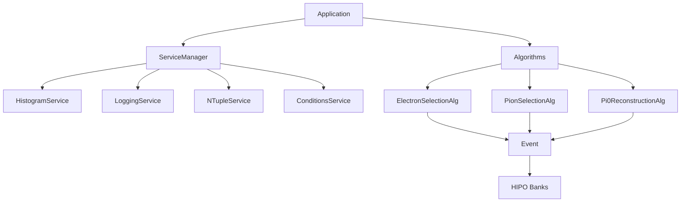

# CLAS12 Analysis Framework

**A modern particle physics analysis framework for CLAS12 data**

[]()
[]()
[]()
[]()

---

## Overview

The CLAS12 Analysis Framework is a modern C++20 framework designed to make particle physics analysis:

- **Cleaner** - Less boilerplate, more physics
- **Safer** - Type-safe interfaces, automated testing
- **Faster** - Built-in parallelization, optimized data structures
- **Maintainable** - Modular design, reusable components

## Key Features

!!! success "Service-Oriented Architecture"
    Modular, reusable services for histograms, logging, N-tuples, and conditions data.

!!! success "Algorithm Framework"
    Clean separation with initialize/execute/finalize lifecycle following Gaudi/Athena patterns.

!!! success "Event Data Model"
    High-level interface abstracting HIPO banks with lazy loading for optimal performance.

!!! success "Cutflow System"
    Automatic efficiency tracking with formatted output tables.

!!! success "Physics Utilities"
    Comprehensive particle selection, cuts, and kinematics calculations.

## Quick Start

```bash
# Clone the repository
git clone https://gitlab.com/MathieuOuillon/clas-analysis clas12-framework
cd clas12-framework

# Configure and build
meson setup build
meson compile -C build

# Run example
./build/main_improved data/data.hipo
```

## Architecture



## Example Analysis

```cpp
#include "Framework/Application.hpp"
#include "Framework/Services/HistogramService.hpp"
#include "Algorithms/ElectronSelectionAlg.hpp"

int main() {
    // Create application
    Framework::Application app("MyAnalysis");

    // Add histogram service
    auto hist_svc = std::make_unique<Framework::HistogramService>();
    hist_svc->set_output_file("output.root");
    app.service_manager().add_service(std::move(hist_svc));

    // Add electron selection algorithm
    auto electron_alg = std::make_unique<Algorithms::ElectronSelectionAlg>();
    app.add_algorithm(std::move(electron_alg));

    // Configure and run
    app.set_input_files({"data/run_5032.hipo"});
    app.set_max_events(10000);
    app.initialize();
    app.run();
    app.finalize();

    return 0;
}
```

## Documentation

| Section | Description |
|---------|-------------|
| [Getting Started](getting-started/installation.md) | Installation and setup |
| [User Guide](user-guide/framework.md) | Detailed framework documentation |
| [Examples](examples/electron-analysis.md) | Complete analysis examples |
| [API Reference](api/index.md) | Full API documentation |

## References

- [Gaudi Framework](https://gaudi.web.cern.ch/) (LHCb/ATLAS)
- [Athena Framework](https://atlassoftwaredocs.web.cern.ch/) (ATLAS)
- [CLAS12 Wiki](https://clasweb.jlab.org/wiki/)
- [HIPO Library](https://github.com/gavalian/hipo)

## License

MIT License - See [LICENSE](https://gitlab.com/MathieuOuillon/clas-framework/-/blob/main/LICENSE) for details.
