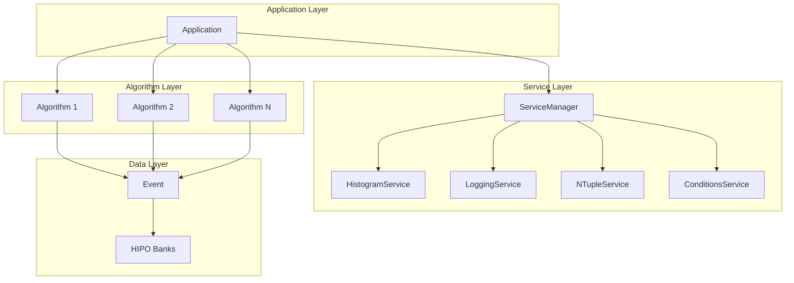
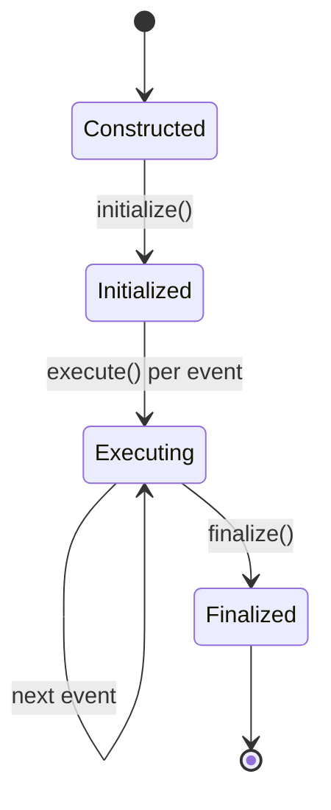

# Framework Architecture

The CLAS12 Analysis Framework follows the service-oriented architecture pattern used in major HEP frameworks like Gaudi (LHCb/ATLAS) and CMSSW (CMS).

## Component Overview



## ApplicationBuilder (Recommended)

The `ApplicationBuilder` provides a fluent API for cleaner application setup:

```cpp
#include "Framework/ApplicationBuilder.hpp"

auto app = Framework::make_application("MyAnalysis")
    .with_input_files({"data.hipo"})
    .with_output("output.root")
    .with_threads(4)
    .with_standard_services()
    .with_version("2.0")
    .with_beam_energy(10.53)
    .with_target("LD2")
    .add_algorithm<Algorithms::EventMonitor>("EventMonitor")
    .add_algorithm<Algorithms::ElectronSelectionAlg>(
        "ElectronSelection", target, polarity)
    .build();

app.initialize();
app.run();
app.finalize();
```

### Builder Methods

| Method | Description |
|--------|-------------|
| `with_input_files(files)` | Set input HIPO files |
| `with_output(filename)` | Set output ROOT file |
| `with_percentage(pct)` | Set percentage of events to process |
| `with_threads(n)` | Set number of processing threads |
| `with_standard_services()` | Add all standard services |
| `with_version(version)` | Set analysis version metadata |
| `with_beam_energy(energy)` | Set beam energy metadata |
| `with_target(target)` | Set target name metadata |
| `add_service<T>(args...)` | Add a custom service |
| `add_algorithm<T>(args...)` | Add an algorithm with constructor args |
| `build()` | Build and return the Application |

## Application (Traditional)

The `Application` class can also be used directly:

```cpp
Framework::Application app("MyAnalysis");

// Configure
app.set_input_files({"data.hipo"});
app.set_num_threads(4);

// Lifecycle
app.initialize();  // Initialize services and algorithms
app.run();         // Process events
app.finalize();    // Cleanup and write output
```

### Key Methods

| Method | Description |
|--------|-------------|
| `add_algorithm()` | Add an algorithm to the processing sequence |
| `service_manager()` | Access the service manager |
| `set_input_files()` | Set input HIPO files |
| `set_num_threads()` | Set parallel processing threads |
| `set_percentage()` | Process a percentage of events |

## ServiceManager

Manages the lifecycle of all services:

```cpp
auto& svc_mgr = app.service_manager();

// Add services
svc_mgr.add_service(std::make_unique<Framework::HistogramService>());
svc_mgr.add_service(std::make_unique<Framework::LoggingService>());

// Retrieve services (in algorithms)
auto* hist_svc = svc_mgr.get_service<Framework::HistogramService>("HistogramService");
```

## Algorithm Lifecycle

Algorithms follow a strict lifecycle:



### Implementation

```cpp
class MyAlgorithm : public Framework::Algorithm {
public:
    explicit MyAlgorithm(std::string name = "MyAlgorithm")
        : Algorithm(std::move(name)) {}

    auto initialize() -> Framework::StatusCode override {
        // Book histograms, get services
        return Framework::StatusCode::SUCCESS();
    }

    auto execute(Framework::Event& event) -> Framework::StatusCode override {
        // Process each event
        return Framework::StatusCode::SUCCESS();
    }

    auto finalize() -> Framework::StatusCode override {
        // Print statistics, cleanup
        return Framework::StatusCode::SUCCESS();
    }
};
```

## Event Data Model

The `Event` class provides a high-level interface to HIPO data:

```cpp
auto execute(Framework::Event& event) -> Framework::StatusCode override {
    // Access particles (lazy loaded)
    const auto& electrons = event.particles(CLAS::PIDs::ELECTRON);
    const auto& photons = event.particles(CLAS::PIDs::PHOTON);
    
    // Access raw banks
    auto rec_particle = event.get_bank("REC::Particle");
    
    // Event store for inter-algorithm communication
    event.store("selected_electron", electrons[0]);
    auto e = event.retrieve<CLAS::Particle>("selected_electron");
    
    // Algorithm decisions
    event.set_decision("HasGoodElectron", true);
    if (event.passes_decision("HasGoodElectron")) {
        // ...
    }
    
    return Framework::StatusCode::SUCCESS();
}
```

## StatusCode

All lifecycle methods return a `StatusCode`:

```cpp
// Success
return Framework::StatusCode::SUCCESS();

// Failure (stops processing)
return Framework::StatusCode::FAILURE();

// Check status
if (sc.is_failure()) {
    // Handle error
}
```

## Directory Structure

```
include/
├── Framework/
│   ├── Application.hpp      # Main application class
│   ├── IAlgorithm.hpp       # Algorithm interface
│   ├── IService.hpp         # Service interface
│   ├── Event.hpp            # Event data model
│   ├── Cutflow.hpp          # Cut efficiency tracking
│   ├── StatusCode.hpp       # Return codes
│   ├── ServiceManager.hpp   # Service lifecycle
│   └── Services/
│       ├── HistogramService.hpp
│       ├── LoggingService.hpp
│       ├── NTupleService.hpp
│       └── ConditionsService.hpp
├── Algorithms/              # Analysis algorithms
├── CLAS/                    # CLAS12-specific utilities
└── Physics/                 # Physics calculations
```

## Best Practices

!!! tip "Service Access"
    Always check if a service was successfully retrieved:
    ```cpp
    m_hist_svc = service<Framework::HistogramService>("HistogramService");
    if (!m_hist_svc) {
        return Framework::StatusCode::FAILURE();
    }
    ```

!!! tip "Event Store"
    Use the event store for inter-algorithm communication instead of global variables.

!!! tip "Cutflow"
    Always use `Cutflow` to track selection efficiency - it's invaluable for debugging.

!!! tip "Logging"
    Use the `Log` singleton for structured logging instead of `std::cout`.
