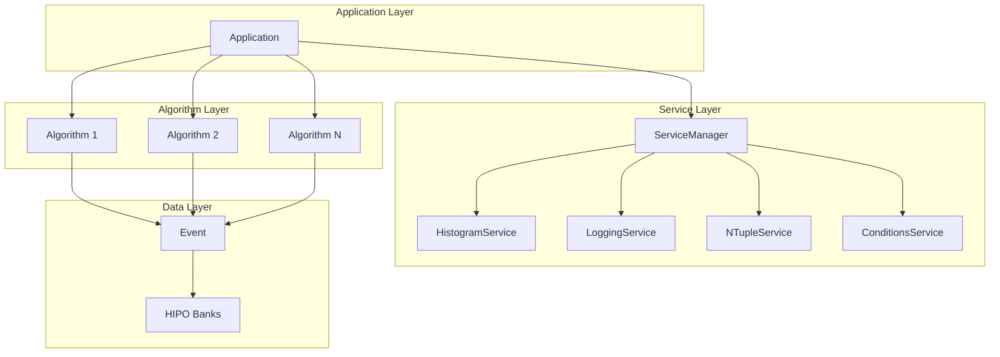
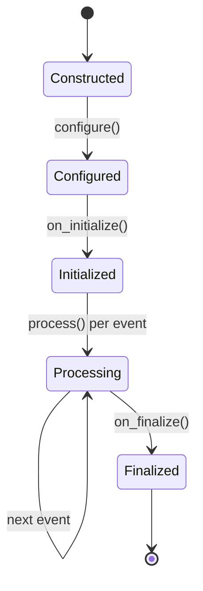

# Framework Architecture

The CLAS12 Analysis Framework follows the service-oriented architecture pattern used in major HEP frameworks like Gaudi (LHCb/ATLAS) and CMSSW (CMS).

## Component Overview



## Directory Structure

The framework is organized into modular components:

```
clas-analysis-1/
├── framework/                     # Core reusable framework library
│   └── include/clas12/framework/
│       ├── Core.hpp              # All-in-one convenience include
│       ├── core/                 # Core components
│       │   ├── Application.hpp
│       │   ├── ApplicationBuilder.hpp
│       │   ├── Algorithm.hpp
│       │   ├── IService.hpp
│       │   ├── Event.hpp
│       │   ├── Cutflow.hpp
│       │   ├── StatusCode.hpp
│       │   └── ServiceManager.hpp
│       └── services/             # Concrete services
│           ├── HistogramService.hpp
│           ├── LoggingService.hpp
│           ├── NTupleService.hpp
│           └── ConditionsService.hpp
├── clas12/                        # CLAS12-specific components
│   └── include/clas12/
│       ├── CLAS12.hpp            # All-in-one convenience include
│       ├── Particle.hpp
│       ├── PIDs.hpp
│       ├── Target.hpp
│       └── physics/              # Physics utilities
│           ├── Kinematics.hpp
│           └── DISAnalysis.hpp
├── algorithms/                    # Standard physics algorithms
│   └── include/clas12/algorithms/
│       ├── selection/            # Particle selection
│       ├── reconstruction/       # Particle reconstruction
│       └── monitoring/           # Event monitoring
├── analyses/                      # User analysis executables
├── examples/                      # Learning examples
└── templates/                     # Scaffolding for new analyses
```

## Namespaces

| Namespace | Description | Include Path |
|-----------|-------------|--------------|
| `clas12::framework` | Core framework | `<clas12/framework/core/...>` |
| `clas12::framework` (services) | Framework services | `<clas12/framework/services/...>` |
| `clas12` | CLAS12-specific | `<clas12/...>` |
| `clas12::physics` | Physics utilities | `<clas12/physics/...>` |
| `clas12::algorithms` | Standard algorithms | `<clas12/algorithms/...>` |

## ApplicationBuilder

The `ApplicationBuilder` provides a fluent API for application setup:

```cpp
#include <clas12/framework/core/ApplicationBuilder.hpp>
#include <clas12/algorithms/monitoring/EventMonitor.hpp>
#include <clas12/algorithms/selection/ElectronSelectionAlg.hpp>

auto app = clas12::framework::make_application("MyAnalysis")
    .with_input_files({"data.hipo"})
    .with_output("output.root")
    .with_threads(4)
    .with_standard_services()
    .with_version("2.0")
    .with_beam_energy(10.53)
    .with_target("LD2")
    .add_algorithm<clas12::algorithms::EventMonitor>("EventMonitor")
    .add_algorithm<clas12::algorithms::ElectronSelectionAlg>(
        "ElectronSelection", target, polarity)
    .build();

app.initialize();
app.run();
app.finalize();
```

### Builder Methods

| Method | Description |
|--------|-------------|
| `with_input_files(files)` | Set input HIPO files |
| `with_output(filename)` | Set output ROOT file |
| `with_percentage(pct)` | Set percentage of events to process |
| `with_threads(n)` | Set number of processing threads |
| `with_standard_services()` | Add all standard services |
| `with_version(version)` | Set analysis version metadata |
| `with_beam_energy(energy)` | Set beam energy metadata |
| `with_target(target)` | Set target name metadata |
| `add_service<T>(args...)` | Add a custom service |
| `add_algorithm<T>(args...)` | Add an algorithm with constructor args |
| `build()` | Build and return the Application |

## ServiceManager

The `ServiceManager` manages the lifecycle of all services. When using `ApplicationBuilder`, services are added automatically via `with_standard_services()`. For custom services:

```cpp
// Add custom service after build()
auto app = make_application("MyAnalysis")
    .with_standard_services()
    .build();

// Access service manager for advanced configuration
auto* cond_svc = app.service_manager().get_service<clas12::framework::ConditionsService>("ConditionsService");
if (cond_svc) {
    cond_svc->set_run_number(5032);
}
```

## Algorithm Lifecycle

Algorithms follow a strict lifecycle with the `Algorithm` base class:



### Implementation

```cpp
#include <clas12/framework/core/Algorithm.hpp>

class MyAlgorithm : public clas12::framework::Algorithm {
public:
    explicit MyAlgorithm(std::string name = "MyAlgorithm")
        : Algorithm(std::move(name)) {}

    auto configure() -> void override {
        // Request services (called automatically before on_initialize)
        m_hist_svc = &require_service<clas12::framework::HistogramService>("HistogramService");
    }

    auto on_initialize() -> clas12::framework::StatusCode override {
        // Book histograms, setup resources (services already available)
        return clas12::framework::StatusCode::SUCCESS();
    }

    auto process(clas12::framework::Event& event) -> clas12::framework::StatusCode override {
        // Process each event
        return clas12::framework::StatusCode::SUCCESS();
    }

    auto on_finalize() -> clas12::framework::StatusCode override {
        // Print statistics, cleanup
        return clas12::framework::StatusCode::SUCCESS();
    }

private:
    clas12::framework::ServiceRef<clas12::framework::HistogramService>* m_hist_svc = nullptr;
};
```

## Event Data Model

The `Event` class provides a high-level interface to HIPO data:

```cpp
auto process(clas12::framework::Event& event) -> clas12::framework::StatusCode override {
    // Access particles (lazy loaded)
    const auto& electrons = event.particles(clas12::PIDs::ELECTRON);
    const auto& photons = event.particles(clas12::PIDs::PHOTON);

    // Access raw banks
    auto rec_particle = event.get_bank("REC::Particle");

    // Event store for inter-algorithm communication
    event.store("selected_electron", electrons[0]);
    auto e = event.retrieve<clas12::Particle>("selected_electron");

    // Algorithm decisions
    event.set_decision("HasGoodElectron", true);
    if (event.passes_decision("HasGoodElectron")) {
        // ...
    }

    return clas12::framework::StatusCode::SUCCESS();
}
```

## StatusCode

All lifecycle methods return a `StatusCode`:

```cpp
// Success
return clas12::framework::StatusCode::SUCCESS();

// Failure (stops processing)
return clas12::framework::StatusCode::FAILURE();

// Check status
if (sc.is_failure()) {
    // Handle error
}
```

## Include Paths Reference

| Component | Include Path |
|-----------|-------------|
| Application | `<clas12/framework/core/Application.hpp>` |
| ApplicationBuilder | `<clas12/framework/core/ApplicationBuilder.hpp>` |
| Algorithm | `<clas12/framework/core/Algorithm.hpp>` |
| Algorithm base | `<clas12/framework/core/Algorithm.hpp>` |
| ServiceRef | `<clas12/framework/core/ServiceRef.hpp>` |
| Event | `<clas12/framework/core/Event.hpp>` |
| Cutflow | `<clas12/framework/core/Cutflow.hpp>` |
| HistogramService | `<clas12/framework/services/HistogramService.hpp>` |
| LoggingService | `<clas12/framework/services/LoggingService.hpp>` |
| NTupleService | `<clas12/framework/services/NTupleService.hpp>` |
| Particle | `<clas12/Particle.hpp>` |
| PIDs | `<clas12/PIDs.hpp>` |
| Kinematics | `<clas12/physics/Kinematics.hpp>` |

!!! tip "Convenience Headers"
    Use `<clas12/framework/Core.hpp>` to include all framework components at once.
    Use `<clas12/CLAS12.hpp>` to include all CLAS12 utilities at once.

## Best Practices

!!! tip "Service Access"
    Use `require_service<T>()` in `configure()` for required services:
    ```cpp
    auto configure() -> void override {
        m_hist_svc = &require_service<clas12::framework::HistogramService>("HistogramService");
    }

    auto on_initialize() -> clas12::framework::StatusCode override {
        // Service is guaranteed valid here
        h_p = m_hist_svc->get()->book_hist1D("/Analysis/p", "p", 100, 0, 10);
        return clas12::framework::StatusCode::SUCCESS();
    }
    ```

!!! tip "Event Store"
    Use the event store for inter-algorithm communication instead of global variables.

!!! tip "Cutflow"
    Always use `Cutflow` to track selection efficiency - it's invaluable for debugging.

!!! tip "Logging"
    Use the `Log` singleton for structured logging instead of `std::cout`.
